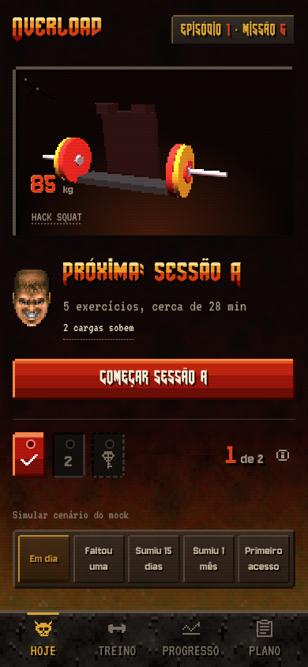
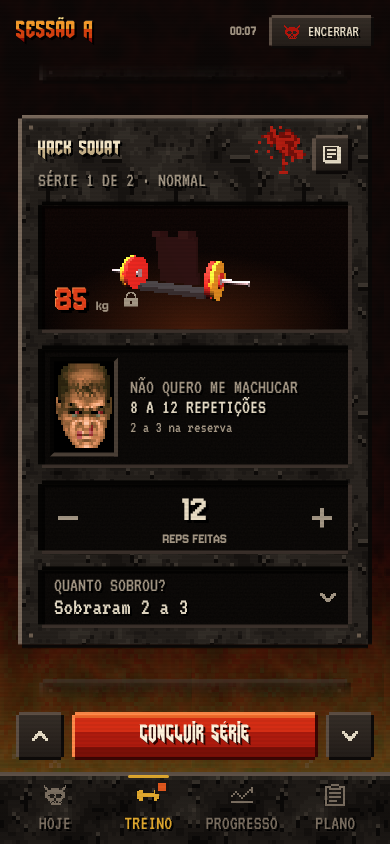
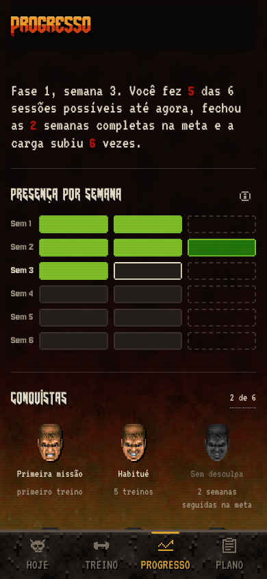

<h1 align="center">Overload</h1>

  <strong>Treino de força que mantém você treinando e faz a carga subir com segurança.</strong> 
  Aberto, sem fins lucrativos e com visual de Doom.

  
  
  

  
  
  

> English in two lines: Overload is an open-source, non-profit workout PWA focused on two things, keeping you consistent and raising your load safely. It is being rebuilt as version 2, designed by one product owner and built by AI agents.

## O que é

O Overload é um app de treino em PWA, aberto e sem fins lucrativos, para que qualquer pessoa tenha acesso a um treino bem estruturado. Ele existe para resolver duas coisas que decidem se alguém evolui na academia: continuar indo e saber quanta carga colocar na barra.

Instala na tela inicial do celular como um app, sem loja. O visual é inspirado em Doom, com Doom faces e pixel art próprias.

## Como funciona

**Um treino conduzido passo a passo.** A sessão vira uma lista de passos, exercício por exercício: calibração da carga, séries de preparo e séries válidas. Você só precisa fazer o que o cartão da tela pede.

**Carga sugerida, com o motivo.** Na primeira vez que faz um exercício, o app pergunta a carga que você usa, de acordo com o esforço esperado naquela série. Das vezes seguintes, ele mostra um cartão: o que você fez da última vez e o que tentar hoje. Se a carga se manteve, o pedido é uma repetição a mais. Se você superou o topo da faixa, o cartão mostra a carga nova e explica por quê.

**Progressão com regra clara.** A carga sobe quando todas as séries chegam ao topo da faixa de repetições e o esforço que você registrou não passa do alvo. O salto respeita o equipamento: 2,5 kg na barra, no Smith e nas máquinas de placas, 5 kg nas máquinas de anilhas e 2 kg por mão nos halteres.

**Uma escala de esforço que você enxerga.** Depois de cada série, você registra quanto sobrou, numa escala de 7 a 13 chamada GER. Cada nível tem a sua Doom face, com o nome do nível e quantas repetições ainda sobravam.

**Preparo automático.** O app decide quantas séries de preparo você faz em cada exercício, pelo estado do músculo naquela sessão: três quando ele estreia, duas quando já trabalhou como acessório, uma quando já foi o principal. A carga do preparo sai de uma rampa de 55%, 70% e 85% do peso de trabalho, e uma série de preparo é pulada quando a carga dela já alcança a de trabalho.

**Descanso que não se perde.** O cronômetro conta pelo horário em que o descanso termina. Se você recarregar a página, ele continua certo. No fim, toca um alarme e o aparelho vibra.

**Constância sem punição.** O app trabalha com uma meta semanal de treinos. Faltar de novo gera só um aviso e uma reação da Doom face, sem castigo na meta nem na fase. As conquistas premiam presença: Primeira missão, Habitué, Veterano, Doom slayer, Sem desculpa (duas semanas seguidas na meta), Rip and tear (três cargas sobem na mesma sessão) e Hellwalker (uma fase inteira na meta).

**Seu protocolo, do seu jeito.** Monte o plano a partir de modelos prontos ou importe e exporte em CSV, uma linha por série. Cada exercício tem GIF e passo a passo, com o filtro neon: verde até o esforço 10 e vermelho de 11 para cima.

**Seus dados são seus.** Cada conta só acessa os próprios dados. Não existe conta de administrador nem de treinador no app.

## Status

O Overload está em reconstrução. Esta é a versão 2, refeita do zero a partir de um mock de alta fidelidade e de um documento de regras de negócio. As telas acima são desse mock, o desenho do que o app vai ser. A versão 1 segue em uso em [overload.app.br](https://overload.app.br), até o v2 substituí-la.

O trabalho está dividido em quatro fases:

1. **Fundação:** o repositório, o contrato para os agentes, o CI, a documentação, o modelo de dados e a conta.
2. **Núcleo do PWA:** regras de progressão, montagem de protocolo, treino, evolução, primeiro login e o visual do mock como componentes.
3. **Migração e desligamento do v1:** levar os dados de quem já usa, com um relatório por pessoa.
4. **Biblioteca fora do app:** um script, rodado fora do app, que atualiza a biblioteca de exercícios.

O [mapa de execução](https://github.com/IgorOlive11/overload/issues/63) mostra, em tempo real, o que está pronto, o que está em andamento e o que espera o quê.

## Feito com agentes de IA

O Overload é construído por agentes de IA, com um Product Owner no comando. Isso não é só um detalhe de bastidor: o método faz parte do projeto, e o repositório inteiro foi organizado para ele.

- **O PO escreve a tarefa.** Cada issue tem objetivo, fontes e critérios de aceite no formato "dado, quando, então", e diz o que fica de fora.
- **O agente planeja antes de programar.** Ele lê a issue, publica um plano e espera a aprovação do PO.
- **Cada critério vira um teste.** O texto do critério é o nome do teste.
- **Outro agente revisa.** Um revisor que não participou da implementação confere o trabalho contra os critérios antes de o PO olhar.
- **As decisões ficam registradas.** Quando algo é decidido, vira um arquivo em [docs/decisoes](docs/decisoes), e nenhum agente reabre uma decisão registrada.

As regras que os agentes seguem estão no [AGENTS.md](AGENTS.md), e o processo completo está em [docs/tecnico/processo-de-desenvolvimento.md](docs/tecnico/processo-de-desenvolvimento.md).

## Tecnologia

React, Vite, TypeScript, Tailwind e Zustand no app. Supabase para autenticação, banco com políticas de acesso por conta e funções de servidor. Deploy na Vercel. Os testes usam o runner do Node e o Playwright. As versões exatas estão no [package.json](package.json).

## Para quem quer estudar ou fazer fork

O código é aberto para isso. Um mapa rápido de onde está cada coisa:

| Pasta | O que tem |
|---|---|
| [docs/produto](docs/produto) | As regras de negócio. Em conflito com qualquer outra fonte, vale esta. |
| [docs/tecnico](docs/tecnico) | Arquitetura, segurança e processo de desenvolvimento. |
| [docs/decisoes](docs/decisoes) | Cada decisão de produto e de arquitetura, com as opções consideradas. |
| [design](design) | O mock de alta fidelidade, as capturas de tela e os assets visuais. |
| `src` | O app. |
| `supabase` | Migrações, funções de servidor e testes do banco. |
| `tests` | Testes, incluindo o oráculo de progressão e carga, gerado a partir do mock. |

Os comandos de desenvolvimento estão no [AGENTS.md](AGENTS.md).

## Licença

O Overload é software livre, distribuído sob a [GNU Affero General Public License v3.0 ou posterior](LICENSE). Em português simples: você pode usar, estudar, modificar e fazer fork. Se publicar uma versão modificada, inclusive como serviço pela internet, precisa oferecer o código dela, sob a mesma licença, a quem a usar. A decisão está registrada em [docs/decisoes/0001-licenca-agpl-3-0-or-later.md](docs/decisoes/0001-licenca-agpl-3-0-or-later.md).

O Overload é um projeto independente. Não tem ligação com a id Software nem com a Bethesda, e Doom é marca dos seus donos.

## Contribuições e segurança

O projeto não recebe issues nem pull requests de terceiros. Veja o [CONTRIBUTING.md](CONTRIBUTING.md). Para relatar uma falha de segurança, siga o [SECURITY.md](SECURITY.md).
